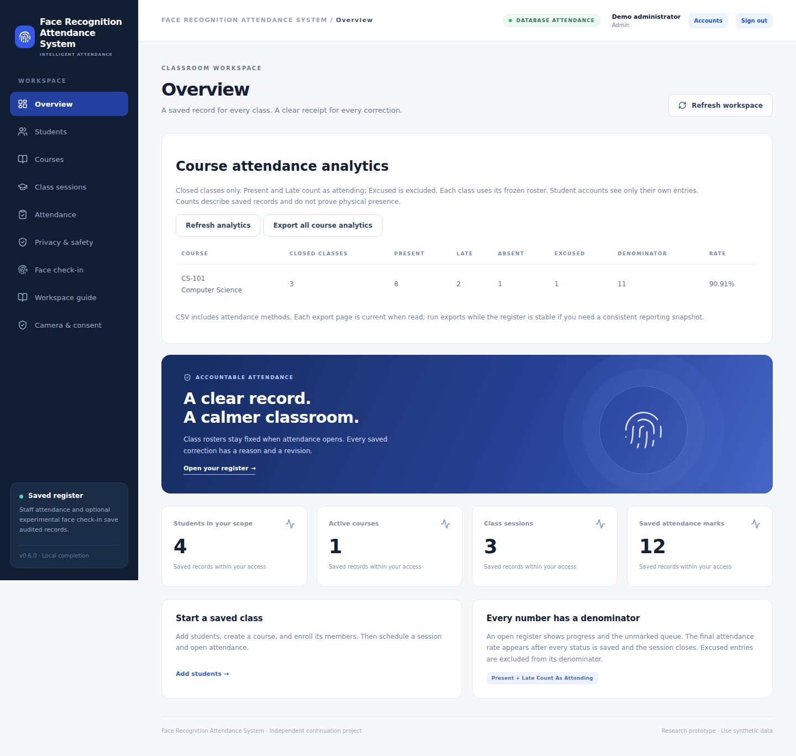
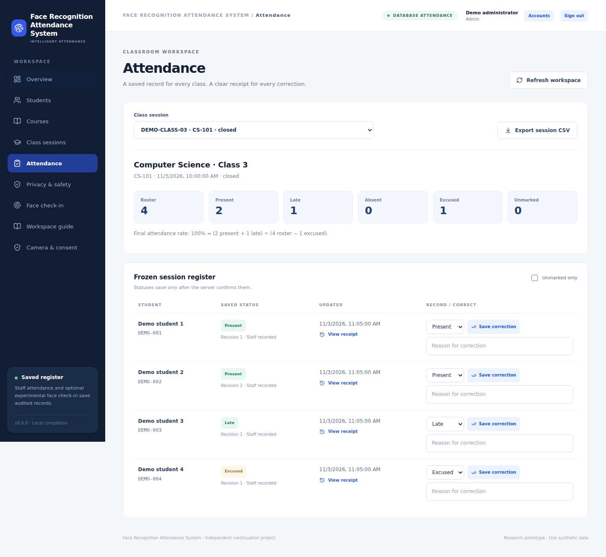
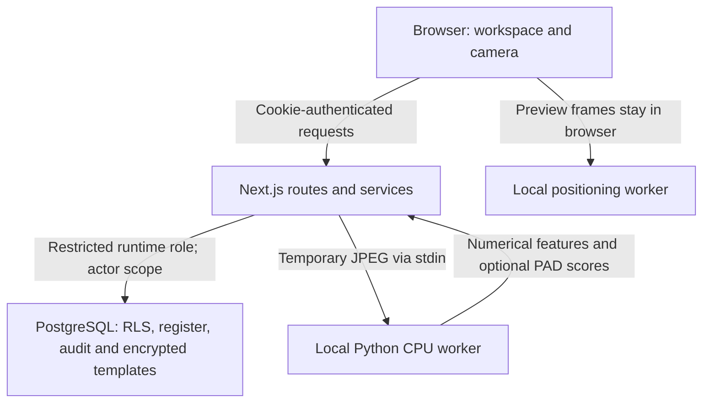

# Face Recognition Attendance System

Free public demo deployment: [Render setup and limits](docs/render.md). The Free service sleeps when idle; automatic attendance timing is unavailable while it sleeps. The full face workload still needs a hosted capacity check.

### A saved record for every class. A clear receipt for every correction.

A role-based attendance application with a persistent class register, frozen session rosters, correction history, CSV exports, course analytics, and an optional experimental face pipeline.

Built with **Next.js 15 · React 19 · TypeScript · PostgreSQL · Better Auth · Python/OpenCV**.

**Status: working local research prototype.** Core register workflows have been demonstrated locally. Face matching and presentation attack detection (PAD) reliability remain unvalidated. Some manual acceptance scenarios are deferred. Docker deployment preparation is included; public hosting has not been created.



*Actual application UI rendered with synthetic local fixtures. These records are illustrative; they are not measured project results or real student data.*

## What it does

| Area | Behavior |
| --- | --- |
| Access | Administrators manage the workspace; teachers work within assigned courses; students read their own records. |
| Class register | Opening attendance freezes the roster. Present, Late, Absent, Excused, and Unmarked have distinct meanings. |
| Corrections | Each saved correction records its reason, actor, server time, revision, and previous/new status. Conflicting updates require a refresh. |
| Reporting | Session CSVs and course analytics use saved records. Present + Late count as attending; Excused is excluded from the denominator. |
| Automatic timing | Explicitly armed classes open on schedule and fill remaining unmarked entries as Absent after the end and processing allowance. Existing marks are preserved. |
| Camera guide | A browser-side face box helps positioning. The name comes from the signed-in student account; it is not an identification result. |
| Face comparison | A fresh capture is compared only with the linked student's own encrypted template. A manual comparison saves a research score. |
| Live comparison | A separate per-run choice enables bounded repeated comparisons while preview stays on. Live scores stay on the page and do not change attendance. |
| Experimental check-in | A qualifying capture can save Present or Late only for an eligible class with a staff policy and the student's separate check-in choice. Reliability is unresolved. |



*Synthetic fixture of the frozen register and revision controls. No real account, image, template, or database record is included.*

## Architecture



See [architecture](docs/architecture.md) for the data flow and [current status](docs/status.md) for evidence and remaining work.

Docker preparation, private runtime configuration and clock diagnosis are described in [deployment](docs/deployment.md). `DEPLOYMENT_VALIDATION.json` distinguishes completed component checks from the pending Docker and live-host checks.

## Run locally

For container deployment preparation and the read-only class-clock diagnostic, see [deployment](docs/deployment.md). The completed one-time name update is documented in [name-update history](docs/rename.md).

This repository contains the complete source in `application/`. Use **Node.js 24**, npm, and a dedicated PostgreSQL development database. The optional face engine uses **64-bit CPython 3.12** and a separate virtual environment.

```powershell
Set-Location .\application
npm ci
Copy-Item .env.example .env.local
```

Complete the database and trusted-account steps in [setup](docs/setup.md) before starting. The example contains placeholders only. For an existing configured installation, preserve its original configuration and encryption key.

```powershell
npm run build
npm start
```

Open [http://localhost:3000](http://localhost:3000) using the configured origin. There is no public sign-up or bundled account password. For development use `npm run dev`; stop a server before starting another on the same port.

## Repository map

| Path | Contents |
| --- | --- |
| `application/app`, `components` | Routes, pages, camera controls, workspace UI |
| `application/lib` | Authorization, register, privacy, encryption, inference and timing services |
| `application/db/migrations` | Nine ordered SQL migrations; no student data or accounts |
| `application/face-engine` | CPU inference source, model manifests, pinned Python requirements, licenses |
| `application/tests` | Isolated software suites and synthetic fixtures |
| `tools` | Source integrity check, safe export helper, and one-commit publishing helper |
| `docs` | Setup, architecture, status, demonstration, and release guide |

## Release and contribution

Run `node tools/verify-release.mjs` from the repository root to check the packaged file list and checksums. [Publishing instructions](docs/publish.md) explain how to create one initial commit and push to your chosen empty GitHub repository. The helper does not initialize or modify your existing running installation.

Environment files, credentials, keys, database archives, face images, model weights, research observations, build output, virtual environments, and `node_modules` are excluded from this source release. The export helper copies a fixed source list rather than copying an installed project recursively.

Historical milestone documentation is preserved under `application/docs`. The top-level [status](docs/status.md) and [setup](docs/setup.md) describe this combined release, including later check-in, timing, camera, and live-comparison additions.

## Limits and licensing

A detection box, account label, similarity score, or high PAD score does not prove identity, liveness, physical presence, or spoof resistance. No biometric accuracy, precision, recall, F1, FMR, or production-readiness claim is made. Live comparison has no PAD or attendance decision. See [evaluation limits](application/docs/EVALUATION_LIMITS.md).

Project-wide licensing has not been selected. Bundled third-party notices are retained; see [third-party notices](docs/third-party.md). Model weights are downloaded separately using the provided manifests. This repository documents an independent continuation project; it does not imply institutional endorsement or deployment approval.
