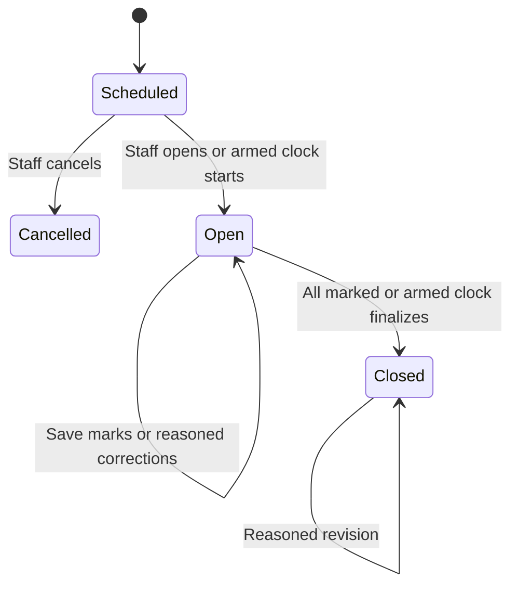

# Architecture and data flow

Face Recognition Attendance System runs as a local Next.js Node application alongside a PostgreSQL database and an optional local Python face engine. The browser never connects directly to PostgreSQL or receives the server encryption key.

## Application boundaries

| Layer | Responsibility |
| --- | --- |
| Browser | Workspace, preview, explicit choices, capture, positioning guide, and display of server-confirmed results |
| Next.js | Verify session and origin; resolve the application role; validate inputs; enforce own-account and per-class eligibility; orchestrate database operations and native inference |
| PostgreSQL | Restricted runtime role, actor-scoped RLS, frozen session rosters, attendance revisions, consent events, research trials, encrypted templates, and automatic class timing functions |
| Python worker | Decode bounded JPEG input, apply quality checks, detect and align a face, derive features, and run the paired PAD models when that workflow requires them |

`DATABASE_URL` is used by trusted setup/operations. Runtime queries use the separate `APP_DATABASE_URL` role. Services use actor-scoped database transactions; UI visibility alone is not an authorization boundary.

## Register lifecycle

Opening captures the active course enrollment into the session roster. Ending enrollment affects future sessions, while existing rosters remain fixed. Initial marks and later corrections save server-confirmed revisions; corrections retain old/new status, actor, time, and reason. Expected revisions prevent silent overwrite of a concurrent correction.

For an armed automatic class, the clock preserves saved marks and fills only remaining unmarked entries as Absent after the class end and allowance. The server must be running for timely processing. Deliberately missed-window recovery still needs its deferred local acceptance observation.

Course analytics include closed sessions in the viewer's scope:

`attendance rate = 100 × (Present + Late) / (roster entries − Excused)`

The zero-denominator result is N/A. These are saved-record statistics, not a measurement of physical presence. Multi-page exports are read page by page and are not a transactional reporting snapshot.

## Camera and face workflows

| Workflow | Frame processing | Persistence / effect |
| --- | --- | --- |
| Preview + box | Browser worker uses bundled JSFeat and its face cascade. | No frame upload by the guide. The label is the signed-in student's authorized account name. |
| Enrollment | An explicitly sent JPEG goes to the local CPU worker. | An encrypted template is stored after the enrollment grant and checks. |
| Manual comparison | A sent capture is compared with that account's own decrypted template in server memory. | Saves a research similarity result; attendance is unchanged. |
| Live comparison | Explicit per-run acknowledgement starts at most one frame per second, one request in flight, bounded to 60 seconds / 60 frames. A resident Python worker avoids loading the engine for each frame. | Scores are shown on the page and not saved as comparison-history rows. No PAD or attendance decision. |
| Experimental check-in | Eligibility, class policy and separate student grant gate paired face/PAD processing and the final database operation. | A qualifying result can save Present or Late with a receipt. Failed attempts do not mark absence. |

Live and manual comparison share the existing attempt budget: up to five attempts/runs per ten minutes. Stop, page hiding, navigation and withdrawal invalidate relevant activity. A response arriving after cancellation must not restore a live score. Worker initialization and native processing still depend on the device; physical-camera latency has not been measured for this release.

Transient image/feature buffers are handled in memory; the application does not save camera JPEGs. Template encryption uses a server-held key. Preserve that original key with its database backup; a new key cannot decrypt old templates. Deletion/withdrawal functions and retention tooling exist, while the full combined browser acceptance scenario remains deferred.

## Source map

- `application/lib/auth`, `lib/server`: identity, access and runtime database connection.
- `application/lib/register`: register service, receipts, CSV and analytics.
- `application/lib/privacy`, `lib/biometric`, `lib/verification`: choices, enrollment, template encryption and own-template comparison.
- `application/lib/checkin`, `lib/automation`: experimental check-in and class timing.
- `application/lib/camera-overlay`, `public/attendai-face-overlay`: local visual guide.
- `application/lib/live-comparison`, `app/api/live-comparison`, `face-engine/live.py`: live leases, endpoint, scheduling and resident worker.

## Deployment boundary

This release targets the existing local Node/Python topology. Public hosting would additionally need a compatible native worker runtime, HTTPS/origin configuration, operational key and database recovery procedures, concurrency work, retention operations, remaining acceptance work, and biometric evaluation. A successful web build does not establish those properties.
